<div align="center">


# ATHAR | أثر

**A wearable IoT system that helps prevent pressure ulcers (bedsores) by alerting caregivers when a patient has not moved for too long.**

*From healthcare challenges to meaningful impact*


</div>

<p align="center">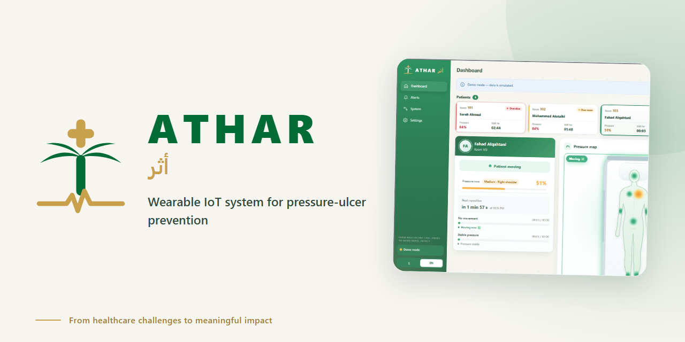</p>

---

## Demo

The real device connected to the dashboard over the internet: when the sensor is moved, the dashboard reacts immediately — the patient card turns green ("Patient moving") and the pressure map glows.

<div align="center">
  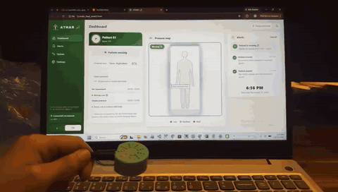
</div>

<!-- VIDEO_PLAYER -->

<p align="center"><a href="media/video/athar_demo.mp4">▶ Download the full demo video with sound (MP4)</a></p>

---

## Table of contents

- [The problem](#the-problem)
- [Our solution](#our-solution)
- [How it works](#how-it-works)
- [Features](#features)
- [Hardware](#hardware)
- [Dashboard](#dashboard)
- [Getting started](#getting-started)
- [Repository structure](#repository-structure)
- [Limitations and future work](#limitations-and-future-work)
- [نبذة بالعربي](#نبذة-بالعربي)

---

## The problem

**Pressure ulcers** (also called bedsores or pressure injuries) are wounds in the skin and the tissue underneath it. They form when the same part of the body carries pressure for a long time without relief — usually over bony areas such as the lower back (sacrum), heels, hips, shoulder blades, elbows and the back of the head.

The people most at risk are those who cannot change position on their own: bedridden and elderly patients, ICU patients, people with spinal-cord injuries and long-term wheelchair users.

Pressure ulcers are **largely preventable**. The standard prevention is simple: reposition the patient regularly so that no area carries pressure for too long. The difficulty is doing it consistently:

- Repositioning schedules depend on caregivers remembering the time and checking each patient manually.
- Nurses care for many patients at once, so a patient who has not moved can easily be missed.
- There is usually no objective record of when the patient last moved or how long pressure stayed on the same spot.
- Once an ulcer forms it is painful for the patient, slow to heal, and adds treatment time and cost.

> **Problem statement:** Caregivers have no simple, real-time way to know which patients have stayed in the same position with constant pressure for too long, so repositioning is missed or delayed and preventable pressure ulcers develop.

## Our solution

**ATHAR** is a small wearable unit placed on the patient, plus a live web dashboard for the caregiver.

1. The wearable measures **movement** (MPU6050 accelerometer) and **pressure** (force-sensitive resistor) all the time.
2. It counts how long the patient has been **still** and how long the pressure has stayed **unchanged**.
3. When **both** pass the allowed time, the patient is marked **"Overdue — reposition now"** and the dashboard raises a red alert with sound, a browser notification and an entry in the alert log.
4. When the patient **moves**, the dashboard shows it in **green** — movement is the goal, not a problem.
5. When the patient moves **and the pressure drops**, ATHAR confirms a **successful repositioning** with a green notification.
6. The caregiver can press **"Repositioned"** to reset the timers or **"Mute"** to silence the alert, from a laptop or a phone.

The name **ATHAR (أثر)** means *impact* in Arabic: turning a common healthcare challenge into a measurable, positive impact on patient care.

## How it works

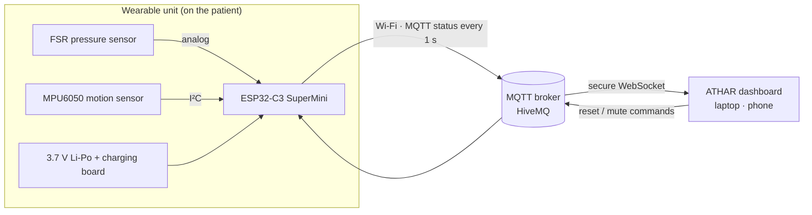

The device and the dashboard never connect directly — both connect to an MQTT broker, so the dashboard works from **any network** (no `localhost`, no same-Wi-Fi requirement). The full message format is documented in [`docs/PROTOCOL.md`](docs/PROTOCOL.md).

### Alert logic

| Situation | What ATHAR shows |
|---|---|
| Patient moves | 🟢 **Patient moving** — green card and glowing pressure map; the "no movement" timer restarts |
| Patient moves **and** pressure drops by ≥ 10 points | 🟢 **Repositioned successfully** — green notification, soft chime, logged |
| Approaching the limit (last quarter of the time) | 🟠 **Due soon** |
| No movement **and** stable pressure for the full time | 🔴 **Overdue — reposition now** — red banner, repeating sound, notification, logged |
| No pressure on the sensor | ⚪ **No patient / empty bed** — no alert |
| Motion sensor not responding | Alert is based on pressure alone, so no alert is missed |

**Movement detection (firmware):** the MPU6050 is sampled 20 times per second. A sample counts as movement if the total acceleration differs from 1 g by more than 0.15 g, or if the change between two consecutive readings is above 0.06 g (catches slow turning and tilting).

**Pressure stability (firmware):** the FSR is averaged and smoothed. A change of more than 8 % (or the sensor becoming loaded/unloaded) restarts the "stable pressure" timer; slow sensor drift does not.

**Timing:** the firmware ships with **10 s** thresholds so the system can be demonstrated quickly, and the dashboard demo uses **2 min**. For real use, set `STILL_SEC` / `STABLE_SEC` in the firmware to the repositioning interval required by the care protocol.

## Features

- **Live pressure map** of the body (head, shoulders, elbows, lower back, heels) coloured green / orange / red by pressure level.
- **"Pressure now"**, **"No movement"** and **"Stable pressure"** timers with progress bars, and the time of the next required repositioning.
- **Red alert** with banner, repeating sound, browser notification, vibration on phones and flashing tab title.
- **Green movement status** and **"successful repositioning"** notification when movement lowers the pressure.
- **Alert log** with time of each alert, movement and repositioning.
- **Two-way control:** "Repositioned" and "Mute" are sent back to the device.
- **Multi-patient demo mode:** five simulated patients in rooms 101–105 with different states; tap a patient to open their details.
- **System page** showing the live data path: sensors → ESP32-C3 → internet → MQTT broker → dashboard, with the status of every step.
- **Bilingual** Arabic (RTL) / English, **responsive** from 320 px phones to large monitors.
- **Reliable connection:** secure WebSocket (`wss`, port 8884) with automatic fallback to port 8000, and a clear message explaining any connection problem.
- **Works with simple firmware too:** if a device sends timers that never increase, the dashboard calculates them itself from the motion and pressure readings.
- **Single file:** the whole dashboard is one `index.html` — no build step, no server.

## Hardware

| Worn on the arm | Assembled inside the 3D-printed case | Components and wiring |
|---|---|---|
| 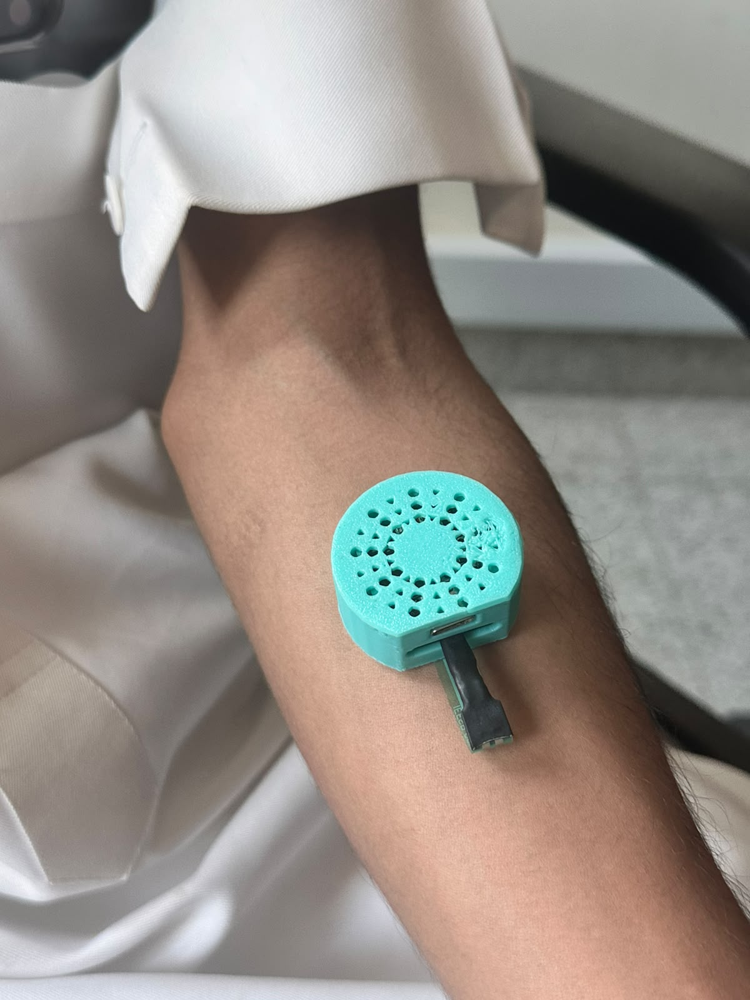 | 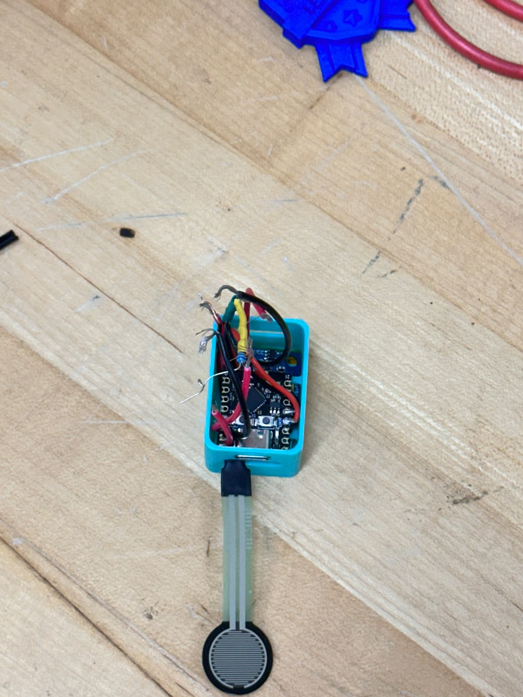 | 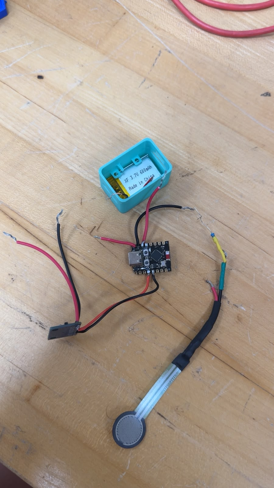 |

### Components

| Component | Role |
|---|---|
| ESP32-C3 SuperMini | Microcontroller with Wi-Fi; runs the detection logic and sends data over MQTT |
| MPU6050 (accelerometer + gyroscope) | Detects patient movement |
| Force-sensitive resistor (FSR, round) + 10 kΩ resistor | Measures pressure on the body area |
| 3.7 V 600 mAh Li-Po battery | Portable power |
| Micro-USB charging board | Charges the battery |
| 3D-printed case | Compact wearable housing with a ventilated patterned lid |

### Wiring

| From | To (ESP32-C3 SuperMini) |
|---|---|
| MPU6050 VCC / GND | 3V3 / GND |
| MPU6050 SDA | GPIO9 |
| MPU6050 SCL | GPIO8 |
| FSR + 10 kΩ voltage divider (output) | GPIO2 (ADC) |

The firmware inverts the FSR reading (`4095 − raw`) to match this divider orientation, so the value rises with pressure. GPIO2, GPIO8 and GPIO9 are boot-strapping pins on the ESP32-C3; this works because the I²C lines idle high, but keep the wiring as shown if you rebuild it.

## Dashboard

Captured from `dashboard/index.html`.

**Live dashboard with the real device (English):**

| Patient moving — shown in green | Overdue patient — red alert |
|---|---|
| 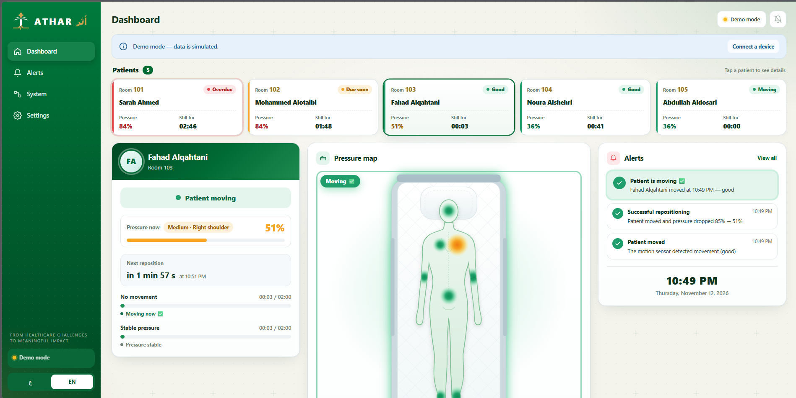 | 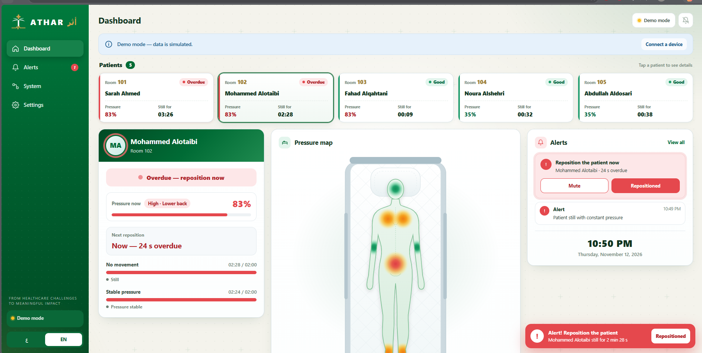 |

**Arabic interface (demo mode with five patients):**

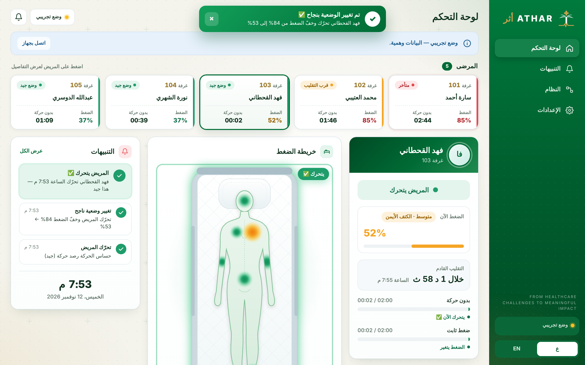

| Red alert for an overdue patient | Phone — patient list | Phone — alert |
|---|---|---|
| 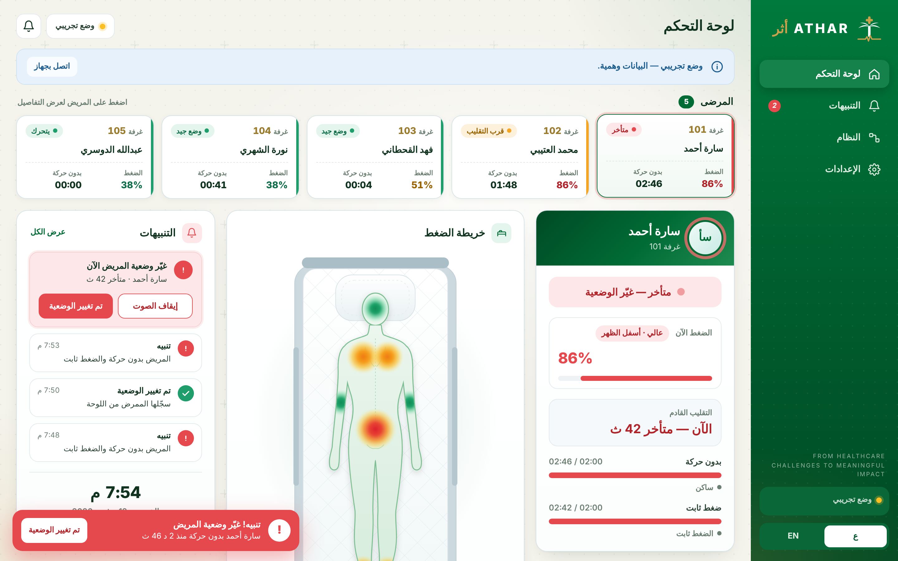 | 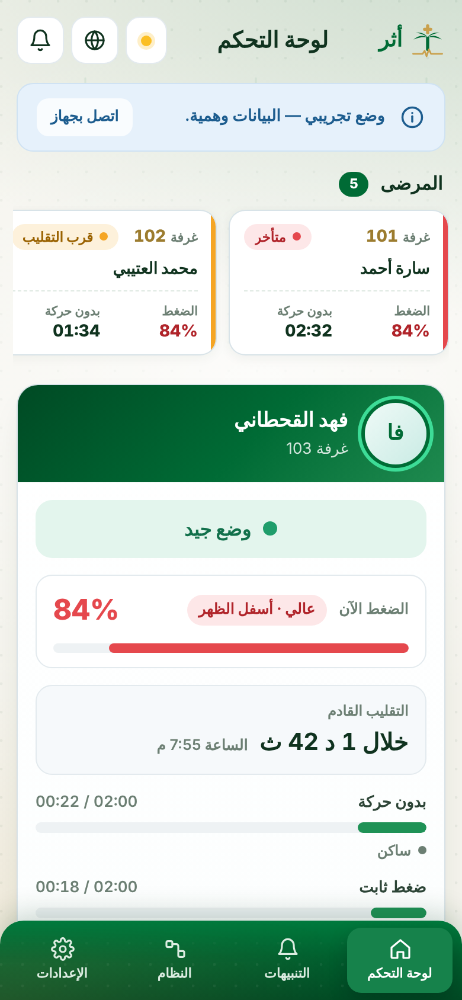 | 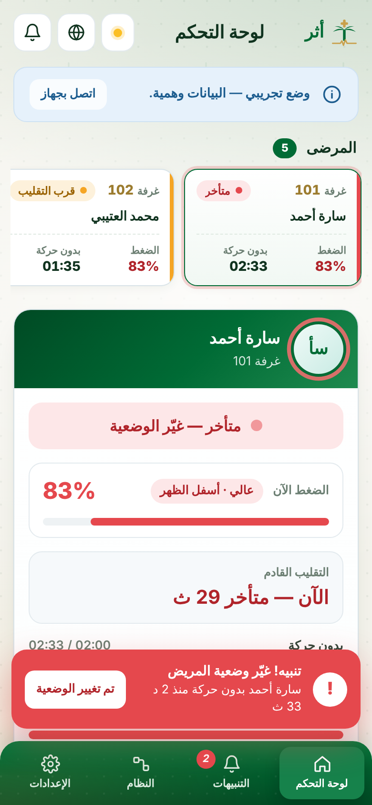 |

**System page — live data path:**

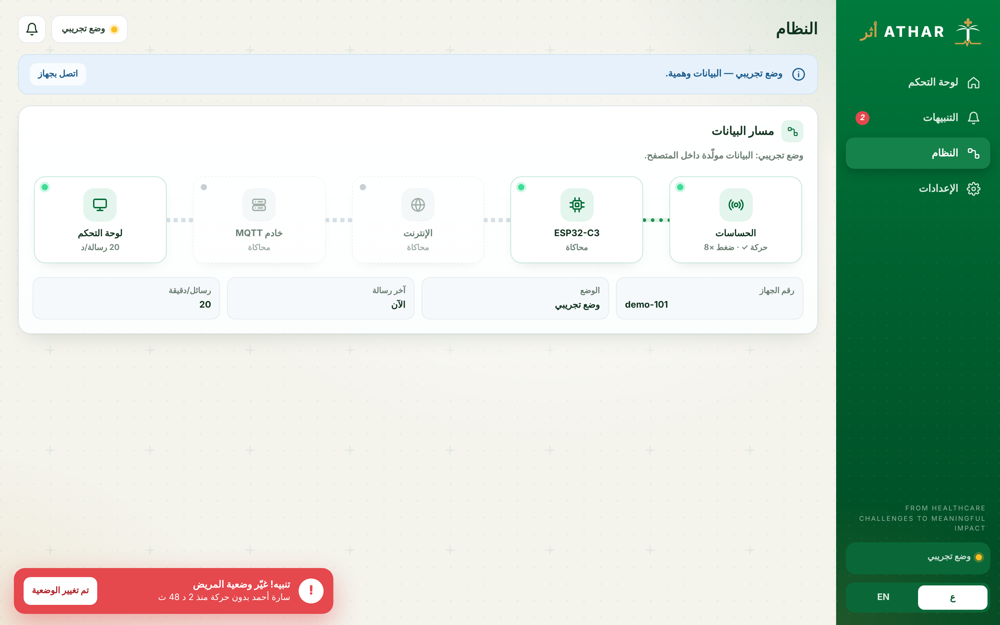

## Getting started

### 1. Flash the firmware

1. Install **Arduino IDE** and add the ESP32 boards URL in *Preferences*:
   `https://espressif.github.io/arduino-esp32/package_esp32_index.json`
2. *Boards Manager* → install **esp32 by Espressif Systems**.
3. *Library Manager* → install **PubSubClient** (Nick O'Leary) and **ArduinoJson** (Benoît Blanchon, version 6.x).
4. Open `firmware/athar_esp32c3/athar_esp32c3.ino` and set:
   ```cpp
   const char* WIFI_SSID     = "YOUR_WIFI_NAME";
   const char* WIFI_PASSWORD = "YOUR_WIFI_PASSWORD";
   const char* DEVICE_ID     = "pc-4821";   // choose your own unique ID
   ```
5. Board: **ESP32C3 Dev Module**, and set **Tools → USB CDC On Boot → Enabled** (required for the Serial Monitor).
6. Upload, then open the Serial Monitor at 115200 baud to see Wi-Fi, MQTT, motion and pressure readings.

### 2. Open the dashboard

- Open `dashboard/index.html` in any modern browser, type the same **Device ID** and press *Connect*.
- Or open it directly with the ID: `dashboard/index.html?device=pc-4821`
- To try it without hardware: `dashboard/index.html?demo` (or press *Demo mode* in the connection window).

The dashboard can also be hosted for free on **GitHub Pages** (*Settings → Pages → Deploy from branch*); with HTTPS, browser notifications work on laptops and phones.

### 3. Simulation (optional)

The [`simulation/`](simulation/) folder contains a Wokwi version of the device with a custom FSR slider chip, so the full system can be tested in the browser.

## Repository structure

```text
ATHAR/
├── dashboard/
│   └── index.html            # complete dashboard (HTML + CSS + JS in one file)
├── firmware/
│   └── athar_esp32c3/
│       └── athar_esp32c3.ino # ESP32-C3 SuperMini firmware (MPU6050 + FSR + MQTT)
├── simulation/
│   ├── README.md
│   └── wokwi/                # Wokwi sketch + custom FSR chip
├── docs/
│   └── PROTOCOL.md           # MQTT topics and status JSON
├── media/
│   ├── logo.svg
│   ├── photos/               # hardware photos
│   ├── screenshots/          # dashboard screenshots
│   └── video/                # demo video (MP4) and animated preview (GIF)
└── LICENSE
```

## Limitations and future work

ATHAR is a **student prototype**, not a certified medical device.

- One FSR covers one body area; a mattress pad with several sensors (through a multiplexer) would cover the whole body map.
- The public HiveMQ broker has no authentication; a real deployment needs a private broker with credentials and TLS on the device side.
- Patient name and room are fixed in the firmware; a backend would allow managing many devices and patients from the dashboard.
- Alert thresholds should be set and validated together with clinical staff.
- Planned: battery-level reporting, on-device buzzer/vibration, push notifications when the dashboard is closed, and long-term history per patient.

---

## نبذة بالعربي

**أثر (ATHAR)** جهاز صغير يُلبس على المريض مع لوحة تحكم على الإنترنت، هدفه **الوقاية من قرح الفراش**.

**المشكلة:** قرح الفراش تصير لما يبقى نفس الجزء من الجسم تحت ضغط لفترة طويلة بدون حركة، خصوصاً عند المرضى اللي ما يقدرون يتحركون بأنفسهم. الوقاية تعتمد على تغيير وضعية المريض بانتظام، لكن الممرض مسؤول عن مرضى كثير وما عنده طريقة لحظية يعرف فيها مين من المرضى صار له وقت طويل بدون حركة.

**الحل:**
- الجهاز فيه **حساس حركة (MPU6050)** و**حساس ضغط (FSR)** على **ESP32-C3**، ويرسل البيانات كل ثانية عبر **MQTT**.
- لو المريض **ما تحرك والضغط ثابت** للمدة المحددة، يطلع **تنبيه أحمر** في اللوحة مع صوت وإشعار.
- لو المريض **تحرك** تطلع الحالة **خضراء**، ولو تحرك **وخف الضغط** يطلع إشعار **"تم تغيير الوضعية بنجاح"**.
- اللوحة تشتغل على اللابتوب والجوال، بالعربي والإنجليزي، ومن أي شبكة.
- الممرض يقدر يضغط **"تم تغيير الوضعية"** أو **"إيقاف الصوت"** من اللوحة.

**التشغيل:** ارفع الكود من `firmware/` بعد ما تكتب اسم الشبكة وكلمة المرور ورقم الجهاز، وافتح `dashboard/index.html` واكتب نفس رقم الجهاز. للتجربة بدون جهاز افتح `dashboard/index.html?demo`.

---

<div align="center">

Made by **[AJC938](https://github.com/AJC938)** · Released under the [MIT License](LICENSE)

</div>
